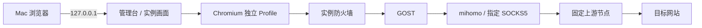

# Claude Browser Containers

在 Apple Silicon Mac 上通过 Docker 运行独立 Chromium 实例的本机管理台。每个实例有自己的浏览器 Profile、Cookie、缓存、下载目录和代理上游。前端使用 React + TypeScript，后端使用 FastAPI。

本仓库只包含源码、通用配置和合成测试数据。浏览器资料、账号登录状态、订阅地址、节点凭据、实例记录、IP 历史、运行截图和备份均保留在使用者本机。

## 功能

- 在网页中创建、启动、停止、重启、改名、移入回收站、恢复和彻底删除实例。
- 添加订阅或手动 SOCKS5，按节点测试延迟和 IP 属性。
- 每个实例包含 browser、proxy、guard 三个容器；复用镜像，独立保存浏览器数据。
- 浏览器只允许经自己的代理出站；代理故障时保留隔离规则。
- 实例第一次成功启动后锁定代理绑定；同名节点变化时需重新确认。
- 启动时检查固定入口 IPv4 与 Claude 出口的国家是否均可确认且相同。
- 在工作区操作远程桌面，支持 Retina 显示、Mac Command 快捷键、中文输入和图片剪贴板。
- 记录同一节点的出口 IP 变化，支持关闭本次提醒和查看本机历史。
- 提供实例备份与恢复命令；备份包含登录状态和凭据，应私密保存。

## 架构



每个实例使用独立 Compose project 和网络。guard 与 browser 共用网络空间，由内核防火墙限制出站。订阅模式下，GOST 与 mihomo 在同一个 proxy 容器中运行；手动 SOCKS5 模式下 GOST 直接连接指定代理。

详细说明见 [容器架构](docs/ARCHITECTURE.md)、[管理台架构](docs/architecture/manager.md)、[API](docs/api/manager.md)和[安全边界](docs/SECURITY.md)。

## 环境要求

Apple Silicon Mac、Docker Desktop、Python 3.12+、Node.js、pnpm、uv，以及可用的代理服务。容器固定使用 Linux ARM64 镜像。脚本不负责安装系统软件，不修改系统代理或宿主防火墙。

## 首次安装

```bash
git clone https://github.com/SeeDaiMa/claude-browser-containers.git
cd claude-browser-containers
```

源码不附带本机下载的二进制、地理数据库或已构建镜像，需要先准备以下资源。

### 1. mihomo

从 [mihomo v1.19.34 官方发布页](https://github.com/MetaCubeX/mihomo/releases/tag/v1.19.34)取得 Linux ARM64 文件。以下命令会校验项目 Dockerfile 中记录的压缩包 SHA-256：

```bash
curl -fL --proto '=https' --tlsv1.2 \
  https://github.com/MetaCubeX/mihomo/releases/download/v1.19.34/mihomo-linux-arm64-v1.19.34.gz \
  -o container/mihomo.gz
printf '%s  %s\n' \
  daaf78a6240a282cdfd75bcbf98fe321f6bd52765cc29e79f344191198f0b50f \
  container/mihomo.gz | shasum -a 256 -c -
gunzip container/mihomo.gz
chmod 755 container/mihomo
```

### 2. 图片剪贴板辅助程序

在项目根目录执行源码注释中的编译命令：

```bash
mkdir -p configs/bin
docker run --rm --platform linux/arm64 -v "$PWD:/src" -w /src \
  alpine:3.24 sh -c 'apk add --no-cache gcc musl-dev libx11-dev && gcc -O2 -Wall -Wextra -o configs/bin/cbc-clipboard-image configs/cbc-clipboard-image.c -lX11'
```

### 3. 国家数据库

自行取得可合法使用的 MaxMind DB 国家数据库，保存为 `backend/resources/Country.mmdb`，详见[数据库说明](backend/resources/README.md)。国家无法确认时，配置代理的实例会无法通过入口与出口国家校验。

### 4. 构建并启动

先启动 Docker Desktop，然后执行：

```bash
./scripts/init.sh
./scripts/setup.sh
./scripts/start-manager.sh
```

打开 http://127.0.0.1:5790 ，在代理库添加自己的订阅，或在创建实例时填写手动 SOCKS5。新安装不会创建默认实例或自带任何账号。

`init.sh` 会准备固定版本镜像，并创建本机 `.env` 和 `images.lock.json`。`setup.sh` 安装项目依赖并构建前端。实例画面使用本机分配的端口；管理台只监听本机 loopback。

## 日常使用

```bash
./scripts/status.sh
./scripts/start.sh <实例ID>
./scripts/stop.sh <实例ID>
./scripts/restart.sh <实例ID>
./scripts/check-proxy.sh <实例ID>
```

实例 ID 可在管理台查看。日常操作优先使用网页。网页创建实例需要代理；CLI 可以先创建离线实例，未配置代理时不能访问公网。

停止和重启会正常关闭 Chromium，等待浏览器保存数据。资源上限可通过本机 `.env` 调整，修改后按需重启相应实例。

本机浏览器首次提示剪贴板权限时选择允许。Mac 的 `⌘C`、`⌘V` 等快捷键会映射到容器内的 `Ctrl`；先点击容器内的输入位置再粘贴。中文输入使用本机输入法，图片粘贴单张上限 20 MB。

## 备份和恢复

```bash
./scripts/stop.sh <实例ID>
./scripts/backup-instance.sh <实例ID> backups/my-instance.tgz
./scripts/restore-instance.sh backups/my-instance.tgz
```

恢复不会覆盖已有实例，也不会自动启动。备份含 Cookie、登录状态、订阅绑定和凭据，不应上传到公开仓库。

## 数据与版本控制

| 本机文件或目录 | 内容 | 是否提交 |
| --- | --- | --- |
| `data/` | Profile、Cookie、缓存、下载 | 否 |
| `configs/<实例ID>/` | 实例信息、代理凭据、生成的运行配置 | 否 |
| `configs/private/` | 订阅、节点、任务和出口历史 | 否 |
| `configs/selection.json` | 实例节点绑定 | 否 |
| `.env`、`images.lock.json` | 本机配置和镜像记录 | 否 |
| `evidence/`、`backups/` | 截图、诊断、抓包和私密备份 | 否 |
| `container/mihomo`、`configs/bin/`、`*.mmdb` | 本机准备的运行资源 | 否 |
| `.env.example`、`configs/*.example.json` | 空白或示例模板 | 是 |

`.gitignore` 对 `configs/` 采用明确的源码文件允许列表，新实例和未知文件默认被忽略。提交前检查暂存内容，不要强制添加私密文件。

## 开发

见[开发与验证](docs/development/manager.md)和[启动说明](docs/deployment/manager.md)。源码中的示例域名、测试密码及测试 IP 用于合成夹具。

真实容器测试和 `scripts/acceptance.sh` 应在专用环境执行，它们可能创建容器或临时改写测试实例配置。运行截图与历史验收记录不随源码发布。

## 依赖与边界

使用 [jlesage/chromium](https://github.com/jlesage/docker-chromium)、[GOST](https://github.com/go-gost/gost)、[mihomo](https://github.com/MetaCubeX/mihomo)、React、FastAPI 等第三方项目，相关组件遵循各自许可。Seccomp 配置基于 Moby，来源见[安全说明](docs/SECURITY.md)。

本项目提供容器、数据和代理网络隔离，不保证网站接受特定代理或账号。目标网站仍可看到代理出口和浏览器常规特征。默认本机 HTTP UI 无独立账号认证，不适合直接公开到互联网。
