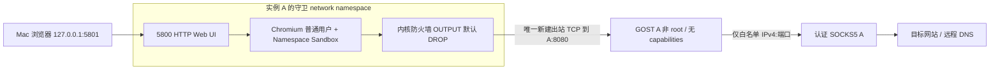

# 架构

每个实例是独立 Compose project（`cbc-claude-a`、`cbc-claude-b`），复用一份 Chromium 镜像和一份 GOST/网络工具镜像。浏览器 Profile、缓存及下载全部位于独立的 `/config` 持久化目录。

## 三个容器的职责

1. **guard**：创建实例自己的 network namespace，先加载 IPv4/IPv6 防火墙，再置为 healthy，之后只有 `sleep` 进程。守卫使用 `NET_ADMIN` 装载规则；抓包工具还需要 `NET_RAW` 和正常降权所需的 `SETGID`。浏览器不继承这些权限。proxy 也只在初始化规则时使用 `NET_ADMIN`，运行 GOST 前清除权限。不开放任何守卫管理服务。
2. **browser**：通过 `network_mode: service:guard` 复用该 namespace，但拥有独立 PID/mount/user 权限上下文；浏览器容器没有 `NET_ADMIN`、`NET_RAW` 或 `SYS_ADMIN`。Chromium 以 UID 1000 启动，并为 renderer 建立更内层的 user/PID/network namespaces 和 Seccomp-BPF Sandbox。
3. **proxy**：GOST 接受实例自己内部 IP 的 HTTP CONNECT。手动 SOCKS5 时，GOST 直接连接该上游。选择订阅节点时，同容器里的 mihomo 只加载这一个节点并使用全局模式，监听 `127.0.0.1:1080`；GOST 只连接这个本地端口。节点服务器地址在 Mac 上解析并固定为一个 IPv4，防火墙只放行该地址的 TCP 端口。两种模式都会在启动时加载白名单，然后切换 UID 65532、清除所有 capabilities 并设置 no-new-privileges。

网页界面由 jlesage 官方镜像内置的最小 GUI/VNC/Web 服务提供。本项目不再部署额外 Nginx、桌面会话或反向代理；镜像自身带有显示 Chromium 窗口所需的 Xvnc/Openbox 和 Web 服务。

## 两个独立网络

以 A 为例：

| 网络 | 子网 | guard/browser | GOST | 用途 |
| --- | --- | --- | --- | --- |
| internal | 10.231.1.0/29 | .2 | .3 | 只允许浏览器连接本实例代理 8080 |
| egress | 10.232.1.0/29 | .2 | .3 | Mac 的 UI 回程，以及 GOST 到固定上游 |

本机 Docker Desktop 的实测结果表明，只把 Web UI 放在 `internal` 网络会导致宿主发布端口不可用，因此守卫同时接入实例 egress 网络。**浏览器 namespace 虽然有公网路由，OUTPUT 默认拒绝仍只放行本实例 GOST 的固定 IPv4:8080。** 这使绕过 Chromium 代理参数的连接也被内核阻断。其他实例有自己的两个子网；两侧代理同时受白名单约束。

浏览器仅在守卫健康后启动，避免防火墙装载前运行。GOST 自己也先装载 DROP，再启动监听。空代理模板生成空上游白名单，GOST 保留无法路由到外部的占位地址，不产生直连默认值。

## DNS、UDP、IPv6

- Chromium 固定 HTTP 代理；`--host-resolver-rules` 拒绝目标域名本地解析，只排除本实例代理的 IP 和 localhost。启动参数使用逐行 `printf`，不用上游镜像的 `eval` 参数解析，避免通配符和空格展开。
- GOST 以原始域名向 SOCKS5 发送请求，不配置 DIRECT/bypass/备用链；用户名密码写入私有 JSON 文件，连接器使用 `socks5` + `notls: true`（标准 SOCKS5，关闭 GOST 扩展 TLS 协商）。
- 防火墙在 `raw/OUTPUT` 提前拦截 Docker DNS `127.0.0.11`，防止 Docker 的 DNS DNAT 绕过普通 OUTPUT/loopback 规则。选择订阅节点时，网站域名由容器内 mihomo 通过该节点做 DoH，不向本机或公网发 UDP/53。本机 DNS 若给出 `198.18.0.0/15` 假地址，启动时会丢掉并改用公网解析。
- 没有 UDP 放行规则；只允许建立到指定代理的 TCP。IPv6 在 namespace sysctl 中关闭，ip6tables 的 INPUT/OUTPUT/FORWARD 同时 DROP。
- Chromium policy 关闭 DoH、DNS prefetch、网络预测、QUIC，并将 WebRTC 设为 `disable_non_proxied_udp`。网络防火墙是最终约束。

## 生命周期和配置

`scripts/cbc.py` 负责校验、生成 GOST 配置、解析上游地址和调用 Compose；所有 shell 入口复用同一实现。节点密码只在订阅库缓存 `configs/private/nodes/`、运行时 `mihomo.json` 和 mihomo 进程内存里；手动 SOCKS5 密码只在管理台写入的 `proxy.json`、运行时 `gost.json` 和 GOST 内存里。旧的 `configs/subscription.json`、`configs/nodes.json` 已在导入订阅库后删除。它们不出现在环境变量、Docker 参数或源码。配置变化产生非秘密 revision，使 Compose 更新代理服务。

`stop.sh` 移除实例运行容器与网络但保留配置、数据，释放浏览器内存。`restart.sh` 重新建立防火墙及浏览器 namespace。`start.sh` 的相同配置可重复执行。端口冲突或启动失败时，仅回收该实例部分创建的运行资源，保存脱敏启动诊断。配置由进程锁串行管理。

正常模式不启用 CDP，不公开 VNC；Web 文件管理器、终端、音频和通知均关闭。只有 `127.0.0.1:<端口>` 的 Web UI 由宿主转发。文本剪贴板使用 Web 客户端内置的双向同步功能，容器设置 `WEB_HOST_CLIPBOARD_SYNC=1`，工作区显式请求启用同步，并通过 iframe 的 `clipboard-read; clipboard-write` 权限策略交由本机浏览器授权。本机截图不走这段文本协议：noVNC 页面在粘贴时把 PNG 发到同一 Web 端口的 `/cbc-clipboard-image`，容器内的辅助进程只把 `image/png` 放到该实例的 X CLIPBOARD，再由远程 Ctrl+V 交给 Chromium。这个接口不新开宿主端口，有网页登录时仍走原来的认证。

固定版本 Web 客户端只在画布获取 DOM 焦点时读取本机剪贴板，从其他标签页返回时可能保留旧文本。`novnc-clipboard-focus.sh` 在容器初始化时补齐窗口激活及画布点击事件，并在断开连接时移除监听；继续复用原有的权限检查和并发读取保护。该脚本参与浏览器修订号计算。

`novnc-keyboard-shortcuts.sh` 将固定客户端的 Mac Command 特例改为通用 Ctrl 修饰键转发，同时映射左右键值与扩展 VNC 物理键码。保留原有按下/释放状态和失焦清理，移除仅适用于 C/V/X 的一次性分支；Shift、Control、Alt 等修饰键不会在 Command 按住时被提前释放。原生 Ctrl、Windows AltGr 和普通键处理保持原路径。该脚本也以只读初始化挂载并参与修订号计算。
