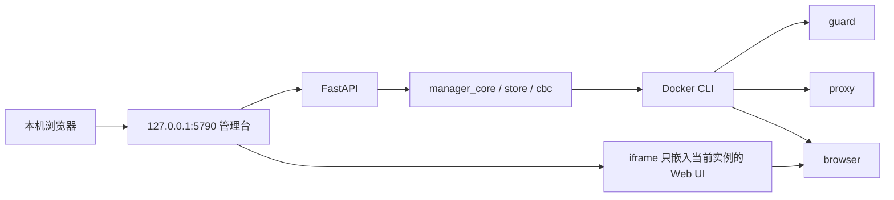

# 实例管理台

管理台跑在 Mac 上，只监听 `127.0.0.1:5790`。一个实例仍是 guard、proxy、browser 三个容器，没有容器嵌套。

网页和 CLI 共用 `scripts/cbc.py` 的 Compose、防火墙和代理生成，以及检查结果的停止/启动失败收尾。订阅解析在 `scripts/catalog.py`，用 PyYAML `safe_load`。下载和解析使用有 30 秒总期限的临时子进程，响应限 2 MiB、节点限 5000、解析结果限 8 MiB。节点 ID、订阅库和显示名称在 `scripts/store.py`。创建、启动、回收等长操作在 `scripts/manager_core.py` 的生命周期队列串行执行。

添加/刷新订阅有独立 worker 和队列，下载不持有 `.manager.lock`；节点检测继续使用自己的队列。两个网络队列只在提交结果时使用存储锁，因此慢订阅不阻塞实例停止。任务持久化另用一把写入顺序锁，快照复制和磁盘提交串行处理；私有记录保留请求摘要用于重启后去重，API 仍只返回公开字段。

实例目录名是不可变 ID。显示名称可以是中文，改名不移动 `configs/<id>` 和 `data/<id>`。

彻底删除先写入 `deleting=true`，再清理数据、其余配置与共享引用，最后移除 `instance.json`。中途失败时登记仍保留在回收站，可以重试清理；部分删除的实例不能恢复。

同实例的生命周期、出口检测、刷新和配置变更通过 `store.instance_operation` 的线程锁与文件锁互斥，CLI 也使用这把锁。全局队列保留原有顺序，检测不会占用其他实例的操作锁。损坏的实例配置单独报告，不修改原件；需要分配端口和网络的新建操作使用严格盘点，遇到损坏配置就停止分配。

Docker 快照共用两秒缓存，一次 `docker ps` 同时采集连接、状态和健康标记。CPU、内存及宿主进程采样共用十秒缓存，内存上限通过一次批量 `inspect` 采集并缓存六十秒，容器 ID 变化时立即刷新。列表读取不做网络探测。前端有活动任务时两秒轮询，空闲五秒，隐藏页面三十秒。

`monitor.py` 的后台线程每十秒观察一次，运行中的实例约每十分钟复测 Claude 出口，初次探测错开最多两分钟；同一轮最多检测一个实例。Docker 不可用、代理配置损坏、节点需要重新确认、手动停止或回收站状态均不会触发自动拉起。旧实例只在当前健康运行且已有有效代理绑定时接管监测，已停止的旧实例保持原状。

组件连续三轮异常或普通代理连接连续两次失败后，恢复任务进入原队列。每次仅使用原绑定配置并重新解析节点服务器 IP；未知的 Claude trace 结果本身不触发恢复。代理单独故障时只重建 proxy，原浏览器和 guard 保留；guard 或浏览器故障则先正常关闭浏览器，再协调重启，防止网络 namespace 脱节。仍使用原有默认拒绝的网络规则。

恢复次数和下次重试时间持久化在实例元数据中，最多三次，等待间隔依次为三十、一百二十、三百秒。达到上限后显示需人工处理；连续健康五分钟且出口检测成功后才清零次数。手动成功启动开启恢复，停止请求立即禁用恢复并使旧任务失效。不会在恢复时修改订阅、重新确认节点或切换其他节点。
